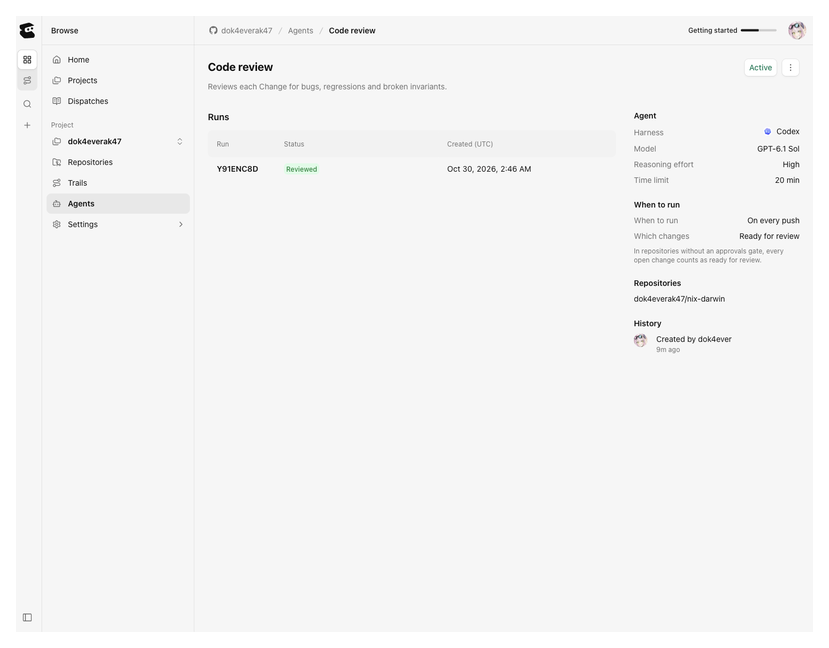
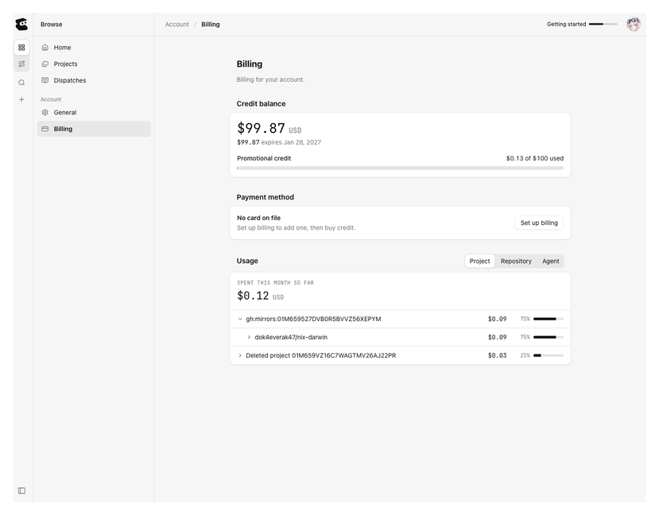

# Entire Code review Agent —— 怎么用

`dok4everak47/nix-darwin` 这个仓库上挂了一个 Entire 的预设 Agent（`Code review`）。
本目录记录它的触发规则和花销情况，方便以后回查「为什么没跑」「什么时候会花钱」。

| 文件 | 作用 |
| - | - |
| `README.md` | 本文件：两张截图怎么读、触发规则怎么落到操作上、不触发时怎么排查 |
| `code-review-trigger.png` | Agent 的 setup 面板截图（模型 / 超时 / 触发条件 / 绑定仓库） |
| `billing-credit.png` | Account → Billing 截图（余额 / 用量拆分 / 有没有绑卡） |
| [config-snapshot.md](config-snapshot.md) | 从页面上逐项抄下来的配置值、官方限制表、实测单价 |

截图时间 **2026-10-30**。数字会变，需要精确值时以整个 Entire 网页为准。

## 一、两张截图分别什么时候看

### `code-review-trigger.png` —— 回答「它现在到底在什么条件下会自动跑」



图里这一段 `AGENT SETUP` 就是自动触发的全部定义：

| 字段 | 当前值 | 含义 |
| - | - | - |
| Harness / Model / Reasoning | `Codex` / `GPT-6.1 Sol` / `High` | 跑起来用哪个模型、多贵的档位 |
| Time limit | `20 min` | 单次运行硬超时，等于间接封顶单次花销 |
| When to run | `On every push` | 触发时机 |
| Which changes | `Ready for review` | 只有处于这个状态的变化才算数 |
| Repositories | `dok4everak47/nix-darwin` | 只在这个仓库生效 |
| Active | 开 | 总开关 |

什么时候看它：

- 推了代码却**没看到 review** —— 先对一遍图里的 Repositories 和 Active
- 想确认**改动的模型或超时**有没有被上游调整（这是 preset Agent，模型由 Entire 维护，会变）
- 想确认**只在 nix-darwin 上生效**、没有误挂到别的仓库

### `billing-credit.png` —— 回答「还剩多少、花在哪、会不会自己扣钱」



三个数字最重要：`Credit balance`（还能花多少）、`expires`（什么时候作废）、`Payment method`（`No card on file` 就意味着不可能自动扣款）。
下面 `Usage` 那张表按 project / repository / agent 拆开，能看出钱是哪个仓库的 review 花的。

什么时候看它：

- 想估「还能跑多少次」——拿余额除以单次花费（小 diff 约 $0.03，8 行配置改约 $0.09，见 [config-snapshot.md](config-snapshot.md)）
- 发现用量涨得不对劲——按 repository 拆行，定位是哪个仓库在跑
- 报销/对账，或想确认没被偷偷绑卡

## 二、触发规则怎么落到操作上

要让它真的跑起来，三步，缺一不可：

1. **开 Trail**：Entire → `dok4everak47/nix-darwin` → Trails → `New trail`，写标题。
2. **挂分支**：进 Trail → 右上 `⋯` → `Add change` → base 选 `main`，head 选你真实的功能分支（分支必须先推到 GitHub，这个对话框不会替你建分支）。
3. **标 ready**：在 change 上点 `Ready for review`。

第 3 步是关键：规则是 `On every push` **且** `Ready for review`，所以

- 光 push 不花钱
- 必须挂在 Trail 上、且处于 Ready for review 的那次 push 才会触发
- `nix-darwin` 有 approvals gate，所以不会「一开 PR 就自动跑」，得显式点 ready（页面原话：*In repositories without an approvals gate, every open change counts as ready for review*）

想不推代码空跑一次：给 Trail 挂个已有分支，然后点 Agent 卡片上的 `Run now`。

### 用 CLI 省掉手动 push 和网页建 Trail

在本仓库里，`entire trail create` 会先把当前分支推到 GitHub，再把它挂到新 Trail 上：

```bash
cd /etc/nix-darwin
git checkout -b fix-something      # 不要直接改 main，main 上没有 Trail 也就不会审
# ...改代码...
git commit -am "fix(shell): ..."

entire trail create --title "fix shell prompt" --type bug
```

之后**只剩一次点击**：打开它打印的 URL，点 `Ready for review`。这一步 CLI 没有对应参数（`entire trail` 全部子命令里都没有 ready/draft 开关），只能在网页上点。

同一分支上后续的 push 会自动再审一次，不需要重建 Trail。看结果可以在终端里跟：

```bash
entire trail watch      # 流式打印该 Trail 的事件（review 开始/结束/findings）
entire trail finding    # 列 findings
entire trail show 2     # 看某个 Trail 的状态
```

收尾：合并照常 `git push origin main`（Entire 的 `Merge` 按钮在单人开发时永远被 approvals gate 拦住，因为不能批准自己的 trail）。合并后 Entire 会自动把 change 标成 `merged`（2026-10-30 实测）。

然后关掉 Trail：网页 `Close`，或 CLI 指定 trail 号和项目：

```bash
# 在带该 Trail 的分支上可以省略 selector
entire trail update --status closed

# 切回 main 之后必须给 trail 号和 --project，否则报 branch "main" has no discoverable project trail
entire trail update 2 --project gh/dok4everak47 --status closed
```

## 三、没跑？按这个顺序排查

1. **仓库的 Trails 开关**：Settings → General → Workflows → `Trails` 必须是开的。关着的话 Agent 根本不会被选中（当初就是先开了它才挂上 Agent 的）。
2. **change 是否真的 Ready for review**：停在 draft / 没点 ready 的状态不触发。
3. **分支还在不在**：把 head 分支删了，change 会变成 `Latest commit is unavailable`，也就不再有可审的内容（2026-10-30 那次 Trail #1 就是这样降级的）。
4. **Agent 是否 Active**：Agents 页面或该 Agent 的 `Code review actions` 菜单里能看/切。
5. **额度是否见底**：余额到 $0，该账号下所有 Agent 停跑（`new runs do not start`）。

## 四、花销怎么控

- **没有硬性花销上限**。Entire 不提供「单次/每日/每月限额」这类设置，`Automatic top-up monthly maximum` 写的就是 `None`。实际起作用的约束只有：预付余额、单次 20 分钟超时、允许小幅超出 $0、自动充值默认关。
- **刹车**：把 Agent 的 `Active` 关掉即停花钱，随时能开回来；或者不点 `Ready for review`。
- 不会自动扣钱：当前 `No card on file` + 自动充值关闭，余额花完就是停跑，不会产生账单。

细节数值和官方限制表见 [config-snapshot.md](config-snapshot.md)。

## 五、重新截图

页面改版后旧图会失真。重截步骤：

1. `entire.com/gh/dok4everak47/-/agents/<agent-id>` → 点 `Show Setup` 展开 `AGENT SETUP` → 截这一段，存 `code-review-trigger.png`
2. `entire.com/account/billing` → 截余额 + 用量区，存 `billing-credit.png`
3. 顺手更新 [config-snapshot.md](config-snapshot.md) 里的数值和本文件顶部的截图日期
